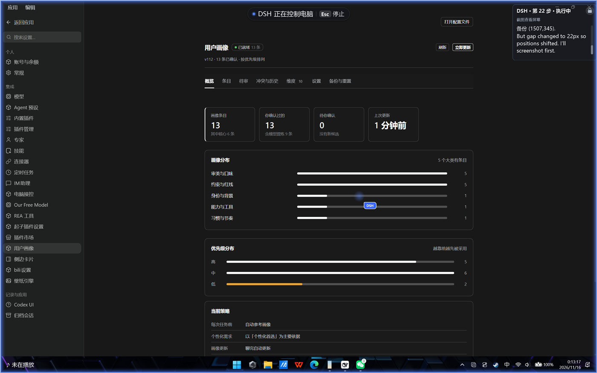
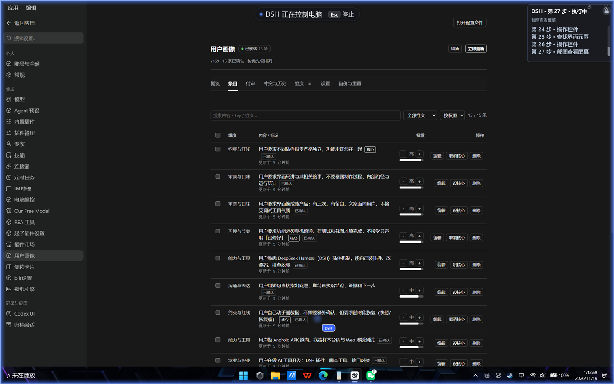
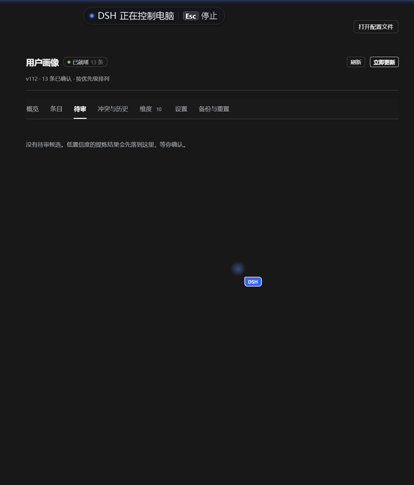
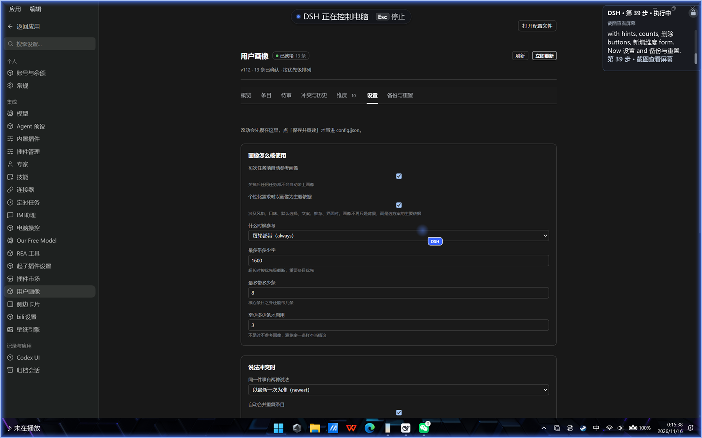

# agent-user-profile

**The user-profile layer for coding agents.** Distill the preferences, habits, skills and red lines scattered across conversations into one durable, weighted portrait — then overlay it on every task by default, and skip it the moment the user says so.

> Current implementation is a DeepSeek Harness (DSH) plugin. The core — portrait schema, admission gate, three-section injection, snapshot rollback — is host-agnostic and the CLI runs on its own.

[](#tests) [](LICENSE) [](#requirements)

**[58-second narrated intro (Chinese)](docs/video/intro-60s.mp4)** · [silent 39s teaser](docs/video/intro.mp4) · [中文 README](README.md)

---

## What it is

A portrait is **not** a chat log and **not** a memory search index. It is a small, curated set of statements about *one* person, each with a weight, a source and an audit trail.

Every task starts with three things:

1. a fixed policy block that lives in the plugin (priority order, when the portrait is primary evidence, when to skip it);
2. the portrait data, split into **red lines / personalization preferences / background**;
3. an explicit opt-out: if the user says "don't use the profile this time", the data is dropped for that turn and the result says so.

## What it is not

| Not this | Because |
| --- | --- |
| A vector database | Portrait entries are claims, not documents. Weights and conflicts matter more than recall. |
| A transcript summarizer | Summaries go stale silently. Every entry is addressable: edit, merge, forget, restore. |
| A prompt-injection machine | Profile text is background knowledge, never an instruction. Red lines are the only exception, and even they lose to explicit in-turn instructions. |
| A telemetry dashboard | The panel only shows things about *you*. Tool-call statistics stay out of it by default. |

## Three things other memory plugins don't do

| | |
| --- | --- |
| **Per-turn opt-out** | "Don't use my profile" is understood, honoured, and acknowledged in the answer — no plugin-wide switch, no settings diving. |
| **Snapshot rollback** | Every destructive write takes a snapshot first (`snapshots/declarations-*.jsonl`, capped at 20). One command — or one click on *Restore points* — puts it back. |
| **Policy separated from data** | How the portrait is used lives in code and cannot be edited or deleted from the portrait. Reset the data and the rules still apply. |

## Six-step memory pipeline (v17)

Recording is gated at every step, and each gate can be switched off on its own.

| Step | What happens | Default |
| --- | --- | --- |
| 1 Trigger | A turn is only mined when the user talks about *themselves*; translation, homework and "why does this error" turns are skipped | `extract.skipEphemeralTurns: true` |
| 2 Extract & normalise | Structured `{dim, key, fact, confidence, scope}` records only — transcripts are never written to disk. Near-duplicates merge; the loser goes to history | `build.dedupe: true` |
| 3 Conflicts & partitions | Contradictions follow `newest` / `freeze`; the ten dimensions roll up into `user_profile` / `user_preference` / `user_social_network` | `conflicts.strategy: newest` |
| 4 Encryption | Backup packages are encrypted on upload (AES-256-GCM); `backup --out --encrypt` too, and `profile unseal` turns one back into JSON | on for uploads |
| 5 Relevance | Only entries related to the current turn are injected; red lines always come through, and the number blocked is stated at the end of the block | `inject.relevantOnly: true` |
| 6 Add / edit / delete | Deletion only ever follows an explicit user command, and takes a snapshot first | always |

Two hard rules live in code rather than in the portrait:

- **No high-risk private data**: national ID, bank card, password and precise address are rejected outright (`--force` overrides) — knowing someone *has* an ID number is risk without portrait value.
- **No raw transcripts on disk**: only structured entries are persisted.

## Screenshots

| Overview | Entries |
| --- | --- |
|  |  |

| Pending candidates | Settings |
| --- | --- |
|  |  |

## Quick start (no DSH required)

```bash
# storage only — the CLI never touches the network
export DSH_USER_PROFILE_HOME=~/.dsh/user-profile   # or any directory you like
node bin/profile.mjs init
node bin/profile.mjs declare --dim taste --fact "prefers dense, monochrome UI" --confidence 0.9 --core
node bin/profile.mjs build --all-scopes
cat "$DSH_USER_PROFILE_HOME/inject.md"
```

`inject.md` is what a host would put in front of the model. Everything else — panel, HTTP routes, extraction — is adapter code.

## Install (DSH)

```bash
node scripts/register.mjs          # links the package into every profile + registers the cordis patch

# restart DSH, then: Settings → 用户画像
```

Requirements: Node >= 20 (uses `node:zlib` zstd for session logs) and a DSH installation for the plugin form. The CLI alone needs nothing but Node.

## Tests

```bash
node _selftest.mjs      # unit: storage, conflict resolution, injection rendering
node _e2e.mjs           # end-to-end: every CLI command + every HTTP action
node _audit.mjs         # adversarial: bad input, path traversal, lost data
node _render.mjs        # renders the real panel component with a tiny hooks runtime
node scripts/verify-install.mjs
```

## Layout

```
index.js               host plugin: hooks, injection, HTTP routes, LLM extraction
client.js              settings panel (hand-written bundle, no build step)
bin/profile.mjs        storage + rendering + CLI (the portable core)
cordis.patch.yml       plugin registration for DSH
scripts/register.mjs   idempotent installer
_selftest.mjs          unit tests        _e2e.mjs      end-to-end tests
_audit.mjs             adversarial tests _render.mjs   panel render smoke test
docs/                  design notes, positioning, changelog
```

## License

MIT — see [LICENSE](LICENSE).
