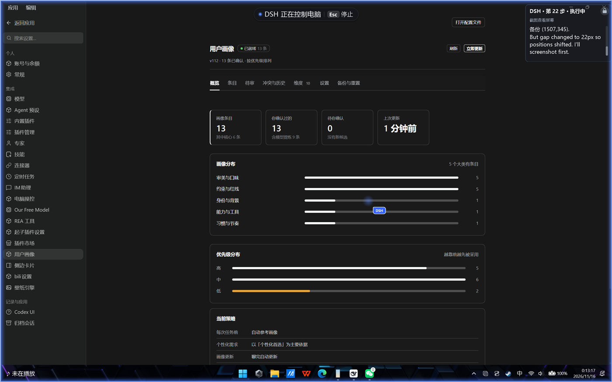
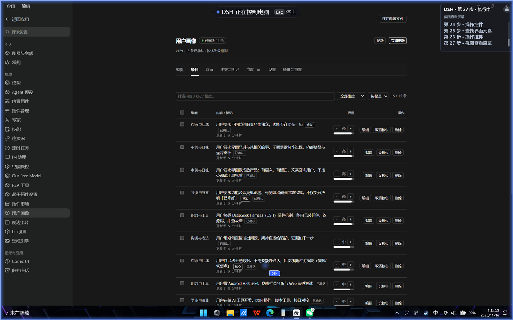

# agent-user-profile

**给 AI 装一份「关于你」的说明书。**

你大概遇到过这种情况：每开一个新对话，都要从头说一遍——我是学生、我喜欢简洁的界面、别动我的项目文件夹、回答先给结论。
这个插件替你把这些记下来，整理成一张清清楚楚的清单；以后每次对话开始前，AI 自动先读一遍，不用你再提醒。

不想用时，当场说一句「这次别用画像」，它立刻停手，并告诉你「本次未结合画像」。

**[看 77 秒介绍片](docs/video/agent-user-profile.mp4)**（中文配音，讲它是干什么的，不讲代码）· [字幕](docs/video/agent-user-profile.srt) · [旁白全文](docs/video/agent-user-profile-narration.txt) · [English README](README.en.md)



## 它解决的那点麻烦

| 以前 | 用了它之后 |
|---|---|
| 每换一个对话，你得重新交代一遍自己 | 它已经知道了，第一句话就能按你的习惯来 |
| 说过的偏好，过几天它又忘了 | 偏好写进清单，一直在，还能调轻重 |
| 它偶尔用了你不喜欢的风格，你懒得再说 | 清单里写明「界面要简洁、不要花哨动画」，它照着做 |
| 担心 AI 把你的私事到处记 | 只有结论上清单，聊天原文不进硬盘；证件号、密码这类直接拒收 |

## 它记什么

四类，都是「换个任务也还成立」的事：

| 类别 | 例子 |
|---|---|
| **你是谁** | 本科在读，学的是无人机系统工程；用中文交流 |
| **你喜欢什么** | 界面要简洁有留白；配色偏冷；文案别用感叹号 |
| **你习惯怎么做** | 先给结论再给理由；要有证据；做完要能跑起来 |
| **你绝对不要什么** | 别动我的项目文件夹；别自作主张删东西；上传前必须打码 |

清单上的每一条都能改：改说法、调轻重（很重要 / 一般 / 随口一提）、标成「底线」、删掉。删错了，去「备份与重置」点一下就能整批还原。

## 它不记什么

- **身份证、银行卡、密码、家庭住址**——直接拒收，不是打码，是不收。
- **这一次任务的细节**：文件名、路径、端口、版本号、报错原文、临时要求——这些换个任务就不成立了，不算你的特征。
- **聊天原文**——硬盘上只有一张清单，对话内容只在内存里过一遍。
- **项目内部的事**——只在某个项目里成立的偏好，不会混进你的通用画像。

## 怎么开始

### 只想先试试（只要有 Node，不用装任何东西）

```bash
git clone https://github.com/kaveys/agent-user-profile.git
cd agent-user-profile
node bin/profile.mjs init
node bin/profile.mjs declare --dim taste --fact "用户偏爱克制的深色界面" --confidence 0.9
node bin/profile.mjs build && node bin/profile.mjs show
```

四行命令之后，你会看到一份整理好的清单——就是这个插件平时喂给 AI 的东西。

### 在 DeepSeek Harness 里用

```bash
cp -r agent-user-profile ~/.dsh/plugins/dsh-user-profile
node ~/.dsh/plugins/dsh-user-profile/scripts/register.mjs   # 注册 + 给每个 profile 建链接
```

然后重启一次 DeepSeek Harness。设置里会多出「用户画像」一栏，七个页签：概览、条目、待审、冲突与历史、维度、设置、备份与重置。

第一次用会看到空清单，这是因为**它不会凭空编你的事**：要等你说话、或者你自己加一条。想快点开始，可以让它「根据我们之前的聊天整理一份」，或者把别的 AI 告诉过你的关于你的信息粘进「备份与重置 → 从别的 AI 搬回来」，它会自动分类、打分、去重。

### 让别的 AI 工具也能用同一份清单

```bash
node mcp/server.mjs
```

这是一个标准 MCP 服务，任何支持 MCP 的客户端都能接上，读同一份画像（这也是「为什么它不绑死在某个宿主上」的原因）。

## 会看见什么



左边是清单，每条带来源（你说的 / 模型提炼的）和轻重；右边「备份与重置」里有恢复点、脱敏扫描和本地导出。

## 常见问题

**它会不会偷偷把我的事传给云端？**
不会主动传。数据只在本机 `~/.dsh/user-profile/`。只有你主动点「上传备份」时才会加密传到你自己配置的网盘（WebDAV），默认是关的。

**它会不会自己乱记？**
有三道门槛：只有你在讲自己时才提炼（翻译、做题、查报错那种纯干活的一轮直接跳过）；提炼出的东西先当候选项，重要的自动进清单，不确定的等你点头。

**删掉的还能找回来吗？**
能。每次删除前自动留一份快照（最多 20 份），面板上一键还原。

**占多少空间？**
一份清单几十 KB，加历史留档也就几百 KB，不含任何图片和聊天记录。

**不用 DeepSeek Harness 能用吗？**
能。数据层是一个独立的命令行工具，MCP 也能单独跑；DeepSeek Harness 只是它的第一个「宿主」。

## 给开发者

想改它、或者想知道它为什么这么设计，看这几份：

- [DESIGN.md](DESIGN.md) — 设计取舍：为什么画像要分三段、为什么用快照而不是撤销、为什么喊停只生效一轮
- [docs/COMPATIBILITY.md](docs/COMPATIBILITY.md) — 换了宿主版本哪些功能会降级
- [docs/POSITIONING.md](docs/POSITIONING.md) — 与同类项目的坐标、以及移植到别的宿主要做什么
- [CONTRIBUTING.md](CONTRIBUTING.md) — 五条硬规矩 + 提交前要跑的检查
- [SECURITY.md](SECURITY.md) — 数据落在哪、哪些边界已知
- [CHANGELOG.md](CHANGELOG.md) — 每一版改了什么、为什么

代码结构：`bin/profile.mjs` 是数据层（一个命令行工具），`lib/` 是两个纯函数模块（判定相似与相关），`index.js` 是宿主侧的采集与注入，`client.js` 是设置页界面，`mcp/server.mjs` 是对外接口。全部零依赖、没有构建步骤。

测试与自检（不需要网络，也不需要宿主）：

```bash
node tests/selftest.mjs      # 单元级
node tests/audit-1.mjs       # 十轮对抗排查，各盯一个角度
node tests/audit-10.mjs
node scripts/verify-install.mjs
```

## 许可

[MIT](LICENSE)。数据在你自己的机器上，代码随便改。
